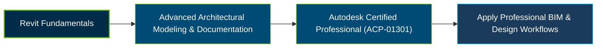

# Autodesk Certified Professional in Revit for Architectural Design (ACP-01301) Certification Exam Guide

A dedicated study guide and technical reference for candidates preparing for the **Autodesk Certified Professional in Revit for Architectural Design (ACP-01301) Certification Exam**, covering advanced architectural modeling, documentation, project standards, collaboration, and information analysis.

---

## Exam Overview

The Autodesk Certified Professional in Revit for Architectural Design certification validates advanced skills in developing, managing, and documenting architectural models. It focuses on professional Revit workflows, project setup, collaboration, and the creation of quality design deliverables.

- **Exam Format**: Proctored, selected-response examination with multiple-choice, drag-and-drop, active-screen, hot-area, and graphic-interpretation questions. Revit software is not available during the exam.
- **Target Audience**: Architectural designers, BIM professionals, Revit modelers, and experienced building design specialists.
- **Prerequisites**: No formal entry prerequisite is specified; candidates are expected to have foundational Revit skills and substantial practical experience, typically around 400–1,200 hours.

---

## Core Exam Domains & Knowledge Areas

### 1. Modeling

- Create and modify architectural and site elements, including walls, floors, roofs, ceilings, stairs, and columns.
- Work with materials, rooms, areas, massing, and topography.
- Create and manage Revit families, family types, parameters, and geometry.

### 2. Documentation

- Create and manage views, view templates, annotations, dimensions, and tags.
- Work with detail components, drafting views, legends, and revisions.
- Organize project documentation using sheets, schedules, and drawing details.

### 3. Collaboration and Coordination

- Use worksharing workflows to coordinate work across project teams.
- Manage linked models and coordinate architectural project information.
- Review collaboration workflows and resolve coordination issues.

### 4. Project Standards and Setup

- Configure project settings, templates, units, and project information.
- Manage project standards, phases, and design options.
- Maintain project organization and consistent modeling workflows.

### 5. Information Analysis

- Create and manage schedules, including advanced schedules and key schedules.
- Develop area schemes and area plans to analyze project information.
- Create sun and shadow studies to evaluate architectural design conditions.

---

## Certification Path

---

## Recommended Practice & Study Resources

Use official Autodesk training, additional study resources, and practical Revit exercises to strengthen the skills covered by the certification.

- **CertsGate**: Explore [ACP-01301 Revit for Architectural Design preparation resources](https://certsgate.com/exams/autodesk/acp-01301) for additional study and knowledge review.
- **Revit Documentation**: Use the official [Autodesk Revit 2027 Help](https://help.autodesk.com/view/RVT/2027/ENU/) to practise architectural modeling, families, documentation, project setup, schedules, and collaboration workflows.

